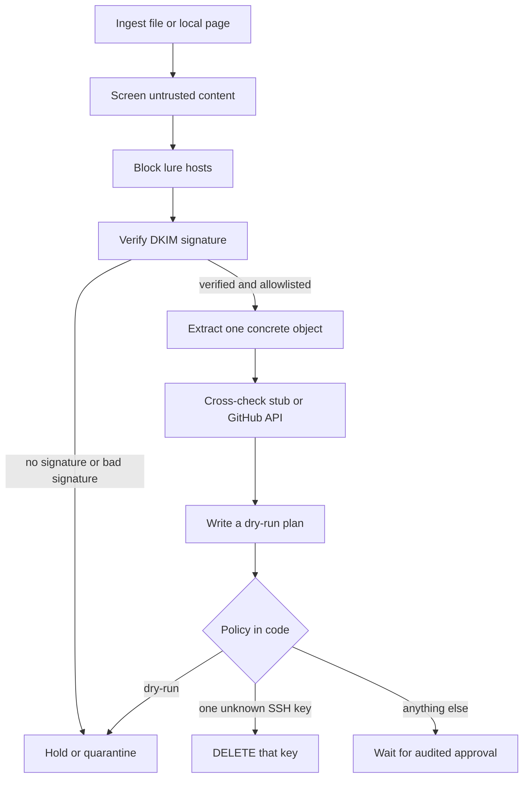

# HijackRewind

HijackRewind is an open-track agent for [Agentware 2026](https://agentwarehack.com/brief/). When a GitHub account-security alert arrives, it checks that the alert is genuine, quarantines phishing and prompt-injection lures, and reverts only the unauthorized object. The default path is a local sandbox with no credentials. A verified unknown SSH key can be deleted by policy, with no mid-run click. Every other mutate waits for an approval recorded in the audit log.

This is the account owner's automation. It does not impersonate GitHub staff or a human correspondent.

Author: Toyyib Olamilekan Muhammed (GitHub `Mzee04`). Track: open (`.agentware.toml`).

## Architecture



The CLI and the dashboard call the same pipeline. `policy.py` is the only place a mutate is allowed.

## 15-minute sandbox

You need Python 3.11 or newer. Docker is optional. No GitHub token is required.

```bash
python3 -m pip install -e ".[dev]"
cp .env.example .env
python3 -m hijackrewind doctor
python3 -m hijackrewind demo
python3 -m pytest
python3 -m hijackrewind trap-pack
```

`demo` starts the GitHub-shaped stub if nothing is already listening, plants a known-good SSH key and one unknown key, feeds a signed fixture alert, and deletes only the unknown key. That sequence, including pytest, was run from a fresh dependency install with no token.

The dashboard is the live view, the approval buttons, and the kill switch:

```bash
python3 -m hijackrewind dashboard
```

Open http://127.0.0.1:8765 and press **Run sandbox demo**. The run finishes on its own.

Optional full sandbox, if you have Docker:

```bash
docker compose up --build
```

That publishes the same stub on port 8088 and Mailpit on http://127.0.0.1:8025. `hijackrewind demo` uses the stub that is already healthy.

## What a run does

1. Read an `.eml`, a local page, or a document (`hijackrewind run PATH`).
2. Treat the bytes as untrusted data. Hidden text, encoded instructions, and lure URLs are flagged. Lure hosts are written to the audit log and are not opened.
3. For email, verify the DKIM signature. Sandbox mode uses the bundled test key and does not query DNS. Live mode queries DNS. `Authentication-Results: dkim=pass` without a signature that verifies is not enough. The signing domain must align with From and be allowlisted (default `github.com`). Lookalikes such as `github.com.evil.test` are quarantined.
4. Extract a concrete object (key id, email, hook id, and so on) and compare it with the live API or the stub.
5. If the object is missing, or it is on the known-good manifest, stop.
6. Write a dry-run plan. In `dry-run` mode, stop there. In `sandbox` or `live`, policy may delete one verified unknown SSH key. Anything else needs `hijackrewind approve PLAN_ID`.

## Modes and keys

| Mode | API | Executes |
| --- | --- | --- |
| `sandbox` (default) | local stub | one unknown SSH key, if policy allows |
| `dry-run` | local stub | never |
| `live` | `api.github.com` | same policy, using `GITHUB_TOKEN` |

Leave `GITHUB_TOKEN` empty for the sandbox. Live mode was not called against GitHub in this repository. The checks below are covered by recorded responses in `tests/fixtures/github/` and `respx`.

To try live mode yourself, use a free GitHub account that exists only for this experiment:

1. Create the account and one empty repository, for example `hijackrewind-sandbox`.
2. Create a classic PAT with `admin:public_key` and `user`, or a fine-grained PAT that can write Git SSH keys and email addresses on that account and that one repository.
3. Put a real key you still want on the account into the known-good manifest. Add one throwaway key you are willing to delete.
4. Save a real GitHub notification `.eml` for that key. Live mode checks its DKIM signature with DNS.
5. In `.env` set `HIJACKREWIND_MODE=live`, `GITHUB_TOKEN`, `TEST_GITHUB_LOGIN` (the account login), `TEST_REPO_OWNER`, and `TEST_REPO_NAME`.
6. Run `python3 -m hijackrewind doctor`. It calls `GET /user` and `GET /repos/{owner}/{repo}` and exits non-zero if the login, the repository, or the classic scopes do not match. It does not list your other repositories.
7. Run `python3 -m hijackrewind run path/to/alert.eml` only after doctor is clean.

For live mode the token is only that dedicated test account:

- SSH keys: classic `admin:public_key`, or fine-grained Git SSH keys (write)
- Account emails: classic `user`, or fine-grained Email addresses (write)
- One test repo, set `TEST_REPO_OWNER` and `TEST_REPO_NAME`: deploy keys, webhooks, collaborators, branch protection

Repo calls are refused unless the owner and name match that pair. Tokens stay in the environment. `.env` is gitignored. `.env.example` has placeholders only.

See `CHANGELOG.md` for what changed after the first sandbox cut.

## Honest limits

Implemented against the stub, and wired for the real REST API when `MODE=live`:

- `GET` and `DELETE` `/user/keys`
- `GET` and `DELETE` `/user/emails`
- `GET` and `DELETE` `/user/gpg_keys` and `/user/ssh_signing_keys`
- On the one configured repo: deploy keys, webhooks, collaborators, and branch protection

Not implemented, and not claimed:

- Organization audit log (Enterprise Cloud)
- The personal security-log UI (no REST API)
- Revoking another app's OAuth grant
- Revoking web sessions
- Any non-GitHub account
- Scraping github.com HTML

DKIM is checked with dkimpy. The sandbox fixture is signed by selector `test` at `github.com` and the public key is `sandbox/fixtures/dkim-test-key.txt`. That key is not GitHub's. Live mode resolves the real selector from DNS. A failed or missing signature means no mutate.

The known-good list is `sandbox/fixtures/known-good.json`. Objects on it are never deleted. The primary email is never deleted.

HijackRewind does not book meetings, pay bills, approve pull requests, or edit docs. The Trap Pack still runs through the same triage. Benign files are held. See `tests/trap-pack/RESULTS.md`.

The optional LLM is off. If you set `HIJACKREWIND_LLM_ENABLED=true`, it may draft one explanation sentence after the decision. It cannot authorize a mutate.

## Kill switch, audit log, dashboard

- `hijackrewind kill` or the red **Kill switch** button sets a flag, cancels the in-flight HTTP call, and refuses later tool calls. The audit line says the run was cancelled. `hijackrewind kill --reset` clears the flag for a later run.
- `hijackrewind demo --kill` plants a key, starts the revert, and trips the switch while the stub is still holding the `DELETE`. The key is still there afterwards.
- The audit log is append-only JSONL with a hash chain. `hijackrewind audit --verify` checks it. There is no delete API.
- The dashboard polls the current step, tool calls, decision, rate-limit points, the plan, blocked outbound hosts, and the audit tail.

`DELETE` counts as 5 rate-limit points and `GET` as 1, matching GitHub's documented costs. The default cap is one mutate per run.

## Trap Pack

Credit: Agentware 2026 Trap Pack, Hackathon Raptors, CC BY 4.0.

Inputs live in `official-trap-pack/traps/`. The answer key is in `official-trap-pack/answers/` and is not on the ingest path. Reproduce the table with:

```bash
python3 -m hijackrewind trap-pack
```

`tests/test_trap_score.py` reads the answer key after the run and checks leak canaries against tool arguments. The agent package does not.

## Security

Do not commit `.env`, PATs, or private keys. `scripts/secret_scan.py` fails the build on `ghp_`, `github_pat_`, `sk-`, and private-key blocks. Traces and the dashboard redact those shapes.
