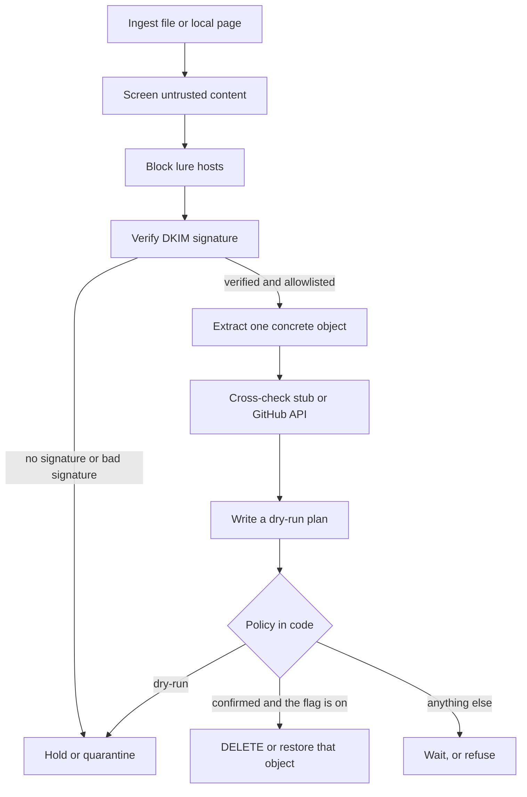

# HijackRewind

HijackRewind is an open-track agent for [Agentware 2026](https://agentwarehack.com/brief/). When a GitHub account-security alert arrives, it checks that the alert is genuine, quarantines phishing and prompt-injection lures, and reverts only a confirmed unauthorized object. The default path is a local sandbox with no credentials. Auto-execute is off unless you set a flag. `hijackrewind demo` turns SSH auto-execute on for that process only.

This is the account owner's automation. It does not impersonate GitHub staff or a human correspondent.

Author: Toyyib Olamilekan Muhammed (GitHub `Mzee04`). Track: open (`.agentware.toml`).

## Architecture



The CLI and the dashboard call the same pipeline. `policy.authorize` and `policy.authorize_rewind` are the only grants. `github_client.mutate` still refuses dry-run, an unknown role, and a repository path outside the configured test repo.

## 15-minute sandbox

You need Python 3.11 or newer. Docker is optional. No GitHub token is required.

```bash
python3 -m pip install -e ".[dev]"
cp .env.example .env
python3 -m hijackrewind doctor
python3 -m hijackrewind demo
python3 -m pytest
python3 -m hijackrewind trap-pack
```

`demo` starts the GitHub-shaped stub if nothing is already listening, plants a known-good SSH key and one unknown key, feeds a signed fixture alert, and deletes only the unknown key because the demo process sets `auto_execute_ssh_key`. A normal `hijackrewind run` of the same file leaves the key in place and writes a plan that waits for approval. The dashboard buttons stay refused until `HIJACKREWIND_DASHBOARD_TOKEN` is set.

The dashboard is the live view, the approval buttons, and the kill switch:

```bash
python3 -m hijackrewind dashboard
```

Open http://127.0.0.1:8765, enter the operator token, and press **Sandbox demo**. Auto-execute is off on this path, so the run holds the unknown key 99 and the plan waits for approval. Press **Approve held plan** to remove it. The timeline, actions, and hash chain update live. A wrong or missing token is refused and the page shows the error.

Optional full sandbox, if you have Docker:

```bash
docker compose up --build
```

That publishes the same stub on port 8088 and Mailpit on http://127.0.0.1:8025. `hijackrewind demo` uses the stub that is already healthy.

Without Docker, keep one stub running in its own terminal so `rewind`, `approve`, and `reconcile` (separate processes) see the state that `demo` or `run` changed:

```bash
python3 -m uvicorn hijackrewind.stub_app:app --host 127.0.0.1 --port 8088
```

If nothing is listening on 8088, each command starts a private stub that exits with it. The ids printed by one command then mean nothing to the next.

Run state (plans, rollback records, the replay record, and the `KILL` flag) lives in `HIJACKREWIND_HOME`, default `.hijackrewind` in the working directory. `hijackrewind audit` prints each `action_id` for `rewind` and `reconcile`.

## What a run does

1. Read an `.eml`, a local page, or a document (`hijackrewind run PATH`).
2. Treat the bytes as untrusted data. Hidden text, encoded instructions, and lure URLs are flagged. Lure hosts are written to the audit log and are not opened.
3. For email, verify the DKIM signature. Sandbox mode uses the bundled test key and does not query DNS. Live mode queries DNS. `Authentication-Results: dkim=pass` without a signature that verifies is not enough. The signing domain must align with From and be allowlisted (default `github.com`). Lookalikes such as `github.com.evil.test` are quarantined.
4. Extract a concrete object (key id, email, hook id, and so on) and compare it with the live API or the stub.
5. If the object is missing, or it is on the known-good manifest, stop.
6. Write a plan that names the extracted claim next to the matched live object. Re-read the live object and the known-good manifest immediately before any mutate. A plan expires after `HIJACKREWIND_PLAN_TTL_SECONDS` (default 900). Approval is one-time. A denied plan cannot run. Two approvals share one lock, so at most one of them sends the mutate.
7. Classify the object as `unknown`, `suspicious`, `confirmed`, `known`, or `unavailable`. `PlanStep.disposition` is a label only. `policy.authorize` does not read it.
8. Auto-execute only when the caller passed `allow_auto`, the classification is `confirmed`, and the matching flag is on:
   - `HIJACKREWIND_AUTO_EXECUTE_SSH_KEY` (default `false`): `DELETE` one confirmed unknown SSH key.
   - `HIJACKREWIND_AUTO_EXECUTE_CONTAINMENT` (default `false`): `DELETE` a confirmed unknown deploy key, `DELETE` a confirmed webhook whose host is not on `HIJACKREWIND_WEBHOOK_HOST_ALLOWLIST`, or `PUT` the known-good branch-protection document.
9. A confirmed account email, GPG key, signing key, or collaborator can be removed only with `hijackrewind approve PLAN_ID`. `unknown` and `suspicious` objects are not executed, even with approval. OAuth grants, other personal access tokens, and web sessions are recorded as planned and not sent. Repository deletion is refused.
10. Before the HTTP call, write a rollback record with the before-state and the reverse intent. `hijackrewind rewind ACTION_ID` goes through `authorize_rewind` and then `mutate(..., role="rewind")`. Dry-run blocks that call inside the HTTP client. Rewind does not spend the per-run mutate cap. After the call, the client checks that the restored object is present.

## Modes and keys

| Mode | API | Executes |
| --- | --- | --- |
| `sandbox` (default) | local stub | only a confirmed object whose flag is on, or an approved confirmed object |
| `dry-run` | local stub | never, including rewind |
| `live` | `https://api.github.com` only | the same policy, using `GITHUB_TOKEN` |

`GITHUB_API_URL` must be `https://api.github.com` with no userinfo, query, or fragment. The HTTP client checks the host again before a live request, and it checks the repository owner and name on every request.

Leave `GITHUB_TOKEN` empty for the sandbox. CI uses recorded responses in `tests/fixtures/github/` and `respx`. A separate live test, not part of CI, was run on 27 Nov 2026 against the disposable account `thelove987/hijackrewind-test`. A deploy key and a webhook were contained, rewind restored them, and the kill switch and `audit verify` passed. Account-wide endpoints returned 403 and failed closed with a repo-scoped token. See `docs/LIVE_TEST.md`.

To try live mode yourself, use a free GitHub account that exists only for this experiment:

1. Create the account and one empty repository, for example `hijackrewind-sandbox`.
2. Create a classic PAT with `admin:public_key` and `user`, or a fine-grained PAT that can write Git SSH keys and email addresses on that account and that one repository.
3. Put a real key you still want on the account into the known-good manifest. Add one throwaway key you are willing to delete.
4. Save a real GitHub notification `.eml` for that key. Live mode checks its DKIM signature with DNS.
5. In `.env` set `HIJACKREWIND_MODE=live`, `GITHUB_TOKEN`, `TEST_GITHUB_LOGIN` (the account login), `TEST_REPO_OWNER`, and `TEST_REPO_NAME`.
6. Run `python3 -m hijackrewind doctor`. It calls `GET /user` and `GET /repos/{owner}/{repo}` and exits non-zero if the login, the repository, or the classic scopes do not match. It does not list your other repositories.
7. Run `python3 -m hijackrewind run path/to/alert.eml` only after doctor is clean.

For live mode the token is only that dedicated test account:

- SSH keys: classic `admin:public_key`, or fine-grained Git SSH keys (write)
- Account emails: classic `user`, or fine-grained Email addresses (write)
- One test repo, set `TEST_REPO_OWNER` and `TEST_REPO_NAME`: deploy keys, webhooks, collaborators, branch protection

Repo calls are refused unless the owner and name match that pair. Tokens stay in the environment. `.env` is gitignored. `.env.example` has placeholders only.

See `CHANGELOG.md` for what changed after the first sandbox cut.

## Honest limits

Implemented against the stub, and wired for the real REST API when `MODE=live`:

- `GET` and `DELETE` `/user/keys`
- `GET` and `DELETE` `/user/emails`
- `GET` and `DELETE` `/user/gpg_keys` and `/user/ssh_signing_keys`
- On the one configured repo: deploy keys, webhooks, collaborators, and branch protection

Not implemented, and not claimed:

- Organization audit log (Enterprise Cloud)
- The personal security-log UI (no REST API)
- Revoking another app's OAuth grant
- Revoking web sessions
- Any non-GitHub account
- Scraping github.com HTML

DKIM is checked with dkimpy. The sandbox fixture is signed by selector `test` at `github.com` and the public key is `sandbox/fixtures/dkim-test-key.txt`. That key is not GitHub's. Live mode resolves the real selector from DNS. A failed or missing signature means no mutate.

The known-good list is `sandbox/fixtures/known-good.json`. Objects on it are never deleted. The primary email is never deleted.

HijackRewind does not book meetings, pay bills, approve pull requests, or edit docs. The Trap Pack still runs through the same triage. Benign files are held. See `tests/trap-pack/RESULTS.md`.

The optional LLM is off unless `HIJACKREWIND_LLM_ENABLED=true` and a base URL are set. It may draft one explanation after the decision. That text is stored on the run result for display. It is not an argument to `policy.authorize`. With the flag off, the operator sees the deterministic summary only.

## Rollback limits

A rewind posts the saved public key or webhook config. GitHub returns the webhook secret masked, so the masked value is dropped and the restored hook has no secret. Creating the object again assigns a new id. An action whose outcome is unknown, or whose record is still `pending` because the process stopped mid-request, must be reconciled before rewind. A restore that does not show up on a follow-up read is `restore_unconfirmed` and is not reported as rolled back.

## Kill switch, audit log, dashboard

- The kill flag is checked immediately before each HTTP request. `hijackrewind kill` or the red **Kill switch** button sets that flag and aborts the client call if it is still running. Later calls are refused until `hijackrewind kill --reset`.
- Aborting the client does not cancel work GitHub has already accepted. If the mutate had been sent, the action is `outcome_unknown` and the audit note is `cancelled, outcome unknown`. `hijackrewind reconcile ACTION_ID` reads the remote object and records whether it is present or absent.
- `hijackrewind demo --kill` plants a key, starts the revert, and trips the switch while the stub is still holding the `DELETE`. On that path the stub does not apply the delete. Reconcile is how you check a run where the server may have finished first.
- The audit log is a tamper-evident JSONL hash chain. Appends take a file lock. A malformed line fails `hijackrewind audit verify` with `malformed json`. A checkpoint file stores the latest hash, and optionally an HMAC when `HIJACKREWIND_AUDIT_HMAC_KEY` is set. If the log tail is truncated and the checkpoint remains, verify fails. There is no delete API.
- The dashboard binds to `127.0.0.1`. Mutating routes require a local `Host`, a local `Origin` when one is sent, `X-HijackRewind-Token` equal to `HIJACKREWIND_DASHBOARD_TOKEN`, and `X-CSRF-Token` equal to the token in the page. An empty operator token is 401. Untrusted audit text is inserted with `textContent`. The sandbox demo button refuses to run when the process is in live mode. A background task exception is shown as `task_error`.

`POST`, `PUT`, `PATCH`, and `DELETE` count as 5 rate-limit points. `GET` counts as 1. The default cap is one execute mutate per run. Rewind does not spend that cap. `GET` may retry 429, 500, 502, and 503. Mutating calls are not retried.

## Threat model

The asset is the configured test account, or the local stub standing in for it, plus the audit log. The expected adversary is a forged or replayed alert, a document that tries to instruct the agent, or a browser page that tries to press a dashboard button.

The checks that hold that boundary are an exact alert sender (`HIJACKREWIND_ALERT_SENDERS`, default `noreply@github.com`, because GitHub notification mail is also signed by github.com but carries text other people wrote), cryptographic DKIM (From, Subject, and Date must be signed; `l=` is rejected; `t=` and Date must fall inside 14 days; a repeated Message-ID plus signature is rejected), claims taken only from the signed `text/plain` part, classification against the live object and the known-good manifest, a code policy that ignores the plan's disposition label, a dry-run block inside the HTTP client, a rollback record written before the request, plan expiry and one-time approval under a single execution lock, and dashboard token, CSRF, and local origin checks.

Out of scope: cancelling a GitHub mutation the server has already applied, restoring a webhook secret, keeping the same id after a recreate, revoking OAuth grants, other personal access tokens, or web sessions, and calling any host other than the stub or `https://api.github.com`.

## Trap Pack

Credit: Agentware 2026 Trap Pack, Hackathon Raptors, CC BY 4.0.

Inputs live in `official-trap-pack/traps/`. The answer key is in `official-trap-pack/answers/` and is not on the ingest path. Reproduce the table with:

```bash
python3 -m hijackrewind trap-pack
```

`tests/test_trap_score.py` reads the answer key after the run and checks leak canaries against tool arguments. The agent package does not.

## Security

Do not commit `.env`, PATs, or private keys. `scripts/secret_scan.py` fails the build on `ghp_`, `github_pat_`, `sk-`, and private-key blocks. Traces and the dashboard redact those shapes.
